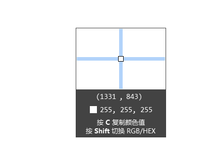
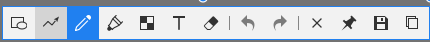
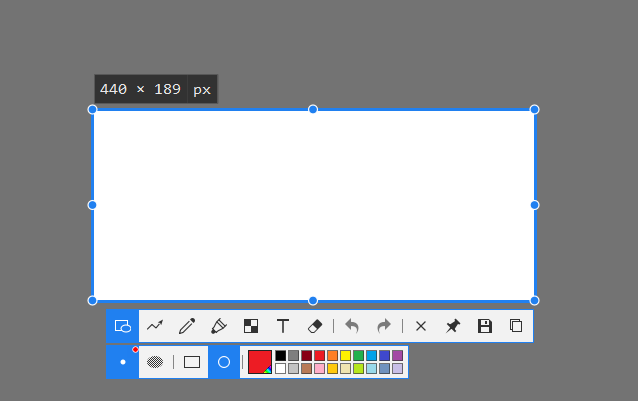
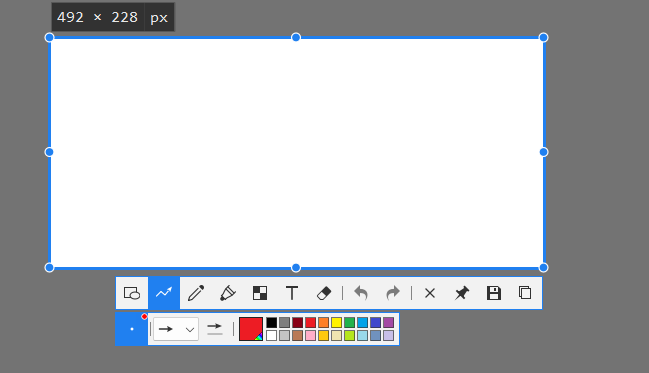
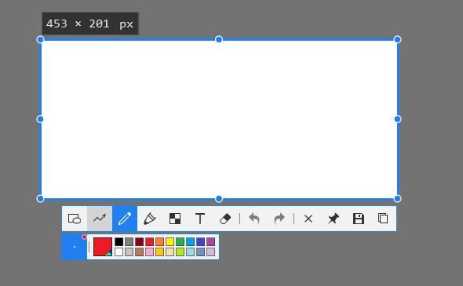
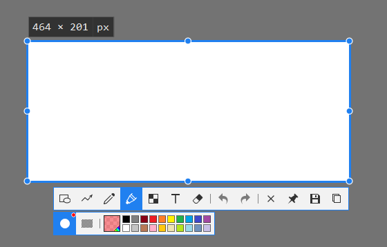
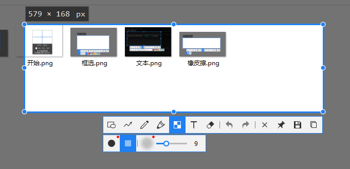
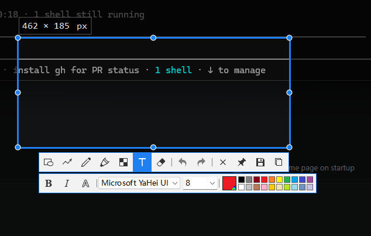
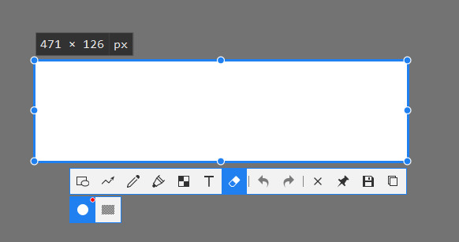

# Windows 真机测试指引

capshot Windows 测试包（2026-10-19 交叉编译 x86_64）

本文两部分：**测试清单**（前置条件 → probe 内核 → capshot.exe 全流程），**界面设计**
（截图层逐元素的设计目标 + Snipaste 参照图 + 与当前实现的差异）。测试时按清单走，
遇到外观/交互争议以「界面设计」章为准。

■ 前置条件
- Windows 10 1809+ / Windows 11
- WebView2 运行时：Win11 自带；Win10 若未装过 Edge WebView2 需先安装
  （https://developer.microsoft.com/microsoft-edge/webview2/）。
  WebView2Loader.dll 随 Release 包附带，与 exe 同目录。

■ 第一步：probe（截图内核，无界面，先验证抓取正确性）
cmd / PowerShell 里运行：
  probe.exe permission
  probe.exe list --snap
  probe.exe target --out t.png
  probe.exe monitor 0 --out m.png
  probe.exe window <id> --out w.png     （id 取自 list）
检查点：
  1. list --snap：candidates 应从顶到底列出普通窗口（任务栏/桌面不出现），
     effective 是物理像素（DPI 150% 时约等于 窗口pt×1.5）
  2. target：优先 via=window；对全屏应用/游戏窗口观察是否自动 too-small 兜底
  3. window：输出图与窗口实际内容一致（Chromium/Electron 若黑帧=PrintWindow 已知限制）
  4. 双屏/不同缩放：m.png 分辨率=该屏物理分辨率；左副屏坐标为负仍应正确

■ 第二步：capshot.exe（完整应用，托盘常驻，无安装）
  双击 capshot.exe → 托盘出现图标。**默认键位已对齐 Snipaste：F1 截图 / F3 贴图（剪贴板）/
  Shift+F3 隐藏显示全部贴图**（旧键 Alt+Shift+A 会在首次启动时自动迁移到 F1）。
  托盘菜单：截图 / 贴图剪贴板 / 隐藏·显示全部贴图 / 解除所有贴图穿透 / 关闭所有贴图 / 历史 / 设置。

  截图层（冻结帧上操作，抓取仍走千问那套：z 序枚举 + 两级抓取）：
  · 悬停高亮窗口；**单击**即采纳整窗，按下即拖则自由框选
  · **Tab / 滚轮**在光标下的命中链里换层级（父子窗、边框内层）
  · 拖框时有钉在选区左上角的 `W × H` 标签 + 像素放大镜（坐标只写在放大镜面板里，
    不再另配一个跟随光标的 `X, Y` 浮标——两者显示条件本来就完全一致，等于同一数字写两遍）
  · **WASD** 移光标 1px；**方向键**移选区；**Ctrl+方向键**外扩、**Shift+方向键**内缩；
    拖拽中**按住 Space** 转为整体移动
  · **Alt** 强制放大镜，**C** 复制颜色，**Shift+C** 切 RGB/HEX
  · **右键**：标注中=结束当前图形；已定选区=退回重新决定；检测态再按=放弃截图（取消也可 Esc）
  · **R** 恢复上次选区，**Ctrl+A** 全屏；**Enter / 双击 / Ctrl+C** 复制，**Ctrl+S / 保存按钮**
    落盘（设置里设了「截图保存位置」就直接存进该目录、同名加 `-1`/`-2` 后缀；没设则弹
    「另存为」选位置，取消则留在截图层），
    **Ctrl+T / 中键** 贴图
  · 工具条（图标 + 悬停显示快捷键）：V形状（矩形⇄椭圆共按钮） P箭头 L画笔 M记号笔 X马赛克 T文字 N序号 E橡皮擦，
    加撤销/重做与贴图/存图/复制/关闭；选工具后出现**按工具定制的属性栏**（对齐 Snipaste）：
    线宽圆点（数值**只能滚轮调**，范围 **1–16 逻辑 px**：绘图区里滚、或把鼠标停在圆点上滚都生效；
    **点击圆点不改变数值**——形状/记号笔/橡皮上它同时是「描边 / 手绘」单选项，点击=选回该模式。
    数值只在**鼠标移入圆点时**以浮标显示，滚动不再有跟随光标的提示气泡。
    橡皮半径 **4–80**、马赛克笔刷直径 **8–80** 同一套规则（各自独立取值，马赛克笔刷刻意不共用
    线宽字段——16 的上限对打码太细，共用会让两处 clamp 互相打架）；
    这两个工具的**圆头/线条模式下光标是画布自绘的圆圈**（隐藏系统光标，圈直径=实际笔刷大小，
    滚轮即时改圈的大小；圈内**不画十字**——录屏实测 Snipaste 没有）；切到矩形模式则回到十字光标。
    **记号笔**是**实心圆、大小跟线宽**（半径 = width×2，即它涂出来的高亮宽度）；**箭头与画笔**
    是**圆点 + 四向短线**，纯当前标注色、点径随线宽实时变。
    马赛克填充模式的粒度另有一个可拖动的滑块，是唯一的非滚轮入口）、
    **填充按钮**（紧挨线宽圆点，仅矩形/椭圆可见；与圆点构成**描边 ⇄ 填充互斥单选组**，
    快捷键 **F** 保留切换语义、改的是同一份状态；选中一个已画的矩形/椭圆时，两者都会连该图形一起改）、
    矩形⇄椭圆切换、箭头样式下拉（—无头 / →单箭头 / ↔双箭头）、
    文字 B/斜体/删除线/字体/字号（不再有「底」按钮）、
    记号笔/橡皮擦的第二个子属性为「矩形模式」按钮（与圆点互斥单选；记号笔=拖框半透明高亮，
    橡皮=框选擦除；默认手绘）。马赛克**只有像素化一种效果**（模糊切换已按需求移除，历史条目里的模糊照常渲染）；
    色板排成**两行 × 10 = 20 色**。橡皮按**区域**擦除（离屏标注层 destination-out 打洞，露出底图，不整块删图形），
    Ctrl+Z 回滚整次擦除、色板、填充、马赛克粒度
    （工具条与**每个工具属性栏**的外观、按钮分组和参照图见下文「界面设计」，逐元素一节）
  · 已画图形可再次点选：拖动、方向键微调、Del 删除；**刚画完那一支**还额外给句柄可拖
    —— 矩形/椭圆 = 四角 + 四边中点共 **8 向缩放**（与选区同一套 `handlePoints`/`resizeRect`），
    箭头 = 两端点，记号笔 = 路径首末点（**画笔不给句柄**，见 39 行）；点别处即定稿
  · 未框选时双击某窗口 = 干净整窗图并直接复制（两级抓取，too-small 自动回退缓存帧）
  · 图片存 %APPDATA%\app.capshot.desktop\history\...

  贴图（Pin）：
  · 出现在截图原位，**与选区像素级对齐**（投影改为窗内自绘，不再有 8px 偏移）
  · 滚轮缩放（光标锚定，带百分比气泡）；**Ctrl+滚轮** 透明度；**中键** 复位
  · 方向键微调 1px；**1/2** 旋转 ±90°；**3/4** 水平/垂直翻转；**+/-** 缩放
  · **Esc / Ctrl+W / 双击** 关闭；**Shift+Esc** 销毁；**Shift+双击** 缩略图模式
  · **右键菜单（当前实际项）**：恢复原始大小 / 放大 / 缩小 / 缩略图模式 / 不透明度(50·75·100%) /
    灰度 / 反色 / 鼠标穿透 / 保持置顶 / 关闭 / 关闭所有贴图
    —— 复制、保存两项**已暂时隐藏**，成因见下文「贴图右键菜单：待办」；
    「重新编辑」已**整条移除**（见同节末条）
  · 开启鼠标穿透后该贴图收不到鼠标事件 —— 用托盘「解除所有贴图穿透」恢复
  · 关掉贴图后再按 **F3**（剪贴板无图时）可复活最近关闭的一张

  贴图右键菜单：待办（隐藏项，恢复条件已写在 `ui/src/pin/PinPage.tsx` 的 openMenu 注释块里）
  · **P1 复制到剪贴板 / 保存** —— 两者都调 `export_result`，而 `export_core`（`commands.rs`）
    是为截图层写的一条龙：无条件 `history.insert()` + 落 PNG/JPEG 两文件、末尾
    `close_session_overlays()`、并把 `last_rect` 改写成贴图自己的 rect。
    后果：贴图每复制/保存一次，历史窗多一条**同图重复**条目（op="pin" 时已入过一次库）；
    「H 恢复上次选区」被顶掉。另外导出的是 sel 原始像素，旋转/翻转/灰度/反色都是 CSS 层的，
    不烘进去 → 与屏上所见不一致。
    恢复条件：`ExportReq` 加 `from_pin`（或 `skip_history`），export_core 据此跳过入库/关会话/写
    last_rect；并定下要不要把当前变换烘进导出图。
    ⚠ 同期 **Ctrl+C / Ctrl+S 仍走这条老路**（摘掉等于贴图没有出图口，属功能回退），待上面收口一起改。
  · ~~**P1 重新编辑…**~~ —— **已整条移除**（不是隐藏）。历史窗那个入口打开就是**空白窗**；
    且它本来就带着三个问题：`open_editor_window(sel)` 用**已烘焙**的 `sel.png` 当底图，
    bootstrap 又把 `s.annotation` 交回编辑器、`controller.loadFrame()` 再还原一遍图形
    → 标注画两遍；编辑器是普通窗、贴图 always-on-top，重叠时编辑器被压在下面；
    编辑导出后贴图不刷新（img src 是启动时取的 blob URL）。
    删掉的东西：`ui/src/editor/` 与 `ui/editor.html`（含 vite input、capabilities 的 `editor-*`）、
    `open_editor_window` / `history_edit` / `windows::open_editor`、bootstrap 的 `editor-` 分支、
    controller 的 `isEditor` 分支、`serialize.parse`（annotationJson 读回侧 + v1 迁移）。
    **数据侧保留**：历史仍写未烘标注底图 `.src.png` 与 `annotation_json` 列，
    重做重编辑时不必回头补数据。
  · ~~**P2 恢复原始大小**~~ —— **已修，菜单项已放回**。原先实现是 `resizeTo(1, null, false)`，
    thumb 写死 false 却**没清 `thumbRestore`**：缩略图模式下点它，窗口按整图放大、
    图像仍乘 thumbScale（THUMB_W/base.w）→ 大窗口里一张小图 + 一圈空白。
    现抽出 `resetZoom()`（zoom→1 + 退出缩略图模式），**菜单项与中键复位共用这一份**，
    不再各写一遍走岔。语义上它只管尺寸：旋转/翻转/透明度/灰度/反色一概不动
    （那些是中键「已复位」的活）。
  · **P3 菜单句柄泄漏** —— 每次右键都 `Menu.new` + `Submenu.new` + ~14 个 `MenuItem.new`，
    全是宿主侧 resource，`menuRef` 只留最后一个句柄、从不 `close()`。
    资源表挂在 webview 上，贴图关窗即释放，所以是有界泄漏，但一张贴图反复右键会持续涨。
    恢复条件：开新菜单前把上一批 resource（含子项）逐个 `close()`。

  历史窗：单击卡片选中（Shift+单击连选一段）、悬停浮出动作图标（复制 / 贴图 / 打开目录 / 删除），
  顶部「全选」「删除选中」两步确认后批量删；**双击不再进重编辑器**（该功能已移除，见上文）
  · **「在文件管理器中显示」的定位坑（已修，本机实测）** —— 老写法
    `Command::new("explorer").arg(format!("/select,{}", path.display()))` 有两种表现，
    都长得像「点了没反应」：
    1. **混合分隔符**：DB 里的 `png_rel` 恒是 `history/2026/20261028/x.png`，`root.join(rel)`
       拼出 `C:\…\app.capshot.desktop\history/2026/…`。文件 API 认（所以缩略图/复制/删除
       一直好着），explorer 不认 —— 实测**开桌面**。改由 `HistoryStore::abs` 按 `/` 拆段
       逐段 push，png/src/thumb/删除四条路都走它。
    2. **引号包错地方**：路径含空格（用户名带空格就踩）时 `arg()` 把整个
       `/select,C:\a b\x.png` 一起加引号 → 实测**开「文档」**。要的是引号只包路径
       `/select,"C:\a b\x.png"`，只有 `raw_arg`（`std::os::windows::process::CommandExt`）
       拼得出这个形状。
    图被外部删掉时 `/select` 也会退化成开「文档」，所以退一步只开它所在目录；
    连目录都不在了就报错（`文件已不在磁盘上：…`），别再静默开一张别的窗口。
    参数形状与路径换算各有一条单测盯着（`commands::tests::explorer_reveal_arg_…`、
    `history::tests::rel_keys_become_native_paths`）。
  设置窗：四个快捷键槽可分别改键（F1–F12 / PrintScreen / Pause 可裸键，其余需修饰键）；
  「截图保存位置」选文件夹后 Ctrl+S 直接落盘、同名自动加 `-1`/`-2`，「改为每次询问」恢复弹框，
  「打开文件夹」/「打开历史原图目录」应能调起资源管理器

## 界面设计

本章给出截图层各界面元素的**设计目标**，参照图为 Snipaste 实拍（`docs/capshot-图/`，
文件名与内容一一对应，无需猜测）。验收时逐图比对：上文「第二步」是操作清单，本章是外观与交互细节。

每节末尾的「当前实现」标注与参照图的差距；未标注即已对齐。

### 1. 开始截图：放大镜与取色

按下快捷键或点击托盘图标后，截图层显示全屏冻结帧，光标处跟随一个放大镜：

- 上半部为放大取样区，叠加**十字准星**：蓝色横竖两条贯穿整个取样区，中心用白色细框单独圈出当前那一个像素
- 取样区下方为**坐标读数**，格式 `(1331 , 843)`（逗号左右各一个空格）
- 再下一行为**色块 + 色值**：小方块后跟 `255, 255, 255`，随光标处像素实时变化
- 底部两行提示，键名加粗：「按 **C** 复制颜色值」「按 **Shift** 切换 RGB/HEX」
- 读数与提示区为深灰底、浅色文字，与取样区拼成一整块，中间**不加分隔线**
- **边框宽度按图示设计**：取样区 1px 深色描边，面板本身不再加粗边框
- **取色阶段的悬停高亮框 = 细芯 + 白晕双描边**（两张参考图一张深色缩略图、一张白底，两种都要成立）：
  1px 主色芯（150% 屏给 2px）外铺一圈 `rgba(255,255,255,0.8)` 晕影。
  原先是 `max(2, handleSize/3)` ≈ 3px **实心蓝单线**——实测压在 `#4c9ff5` 同色背景上**整条线直接消失**。
  选区定稿后的边框同一画法（同一根线的两个阶段，粗细不该变）。放大镜十字本来就是 1px，未动。

当前实现：坐标格式与两行提示文案已与参照图一致；放大镜仅在框选过程中或按住 **Alt** 时出现，选区定稿后隐藏。
坐标只有放大镜面板内这一处——原先另有一个跟随光标的 `X, Y` 浮标，显示条件与放大镜完全相同
（都挂在 `loupeVisible` 上），属纯重复，已删。

### 2. 工具条

确定截图选区后显示工具条（图标按钮，悬停显示名称与快捷键）：

| 分组 | 按钮 | 快捷键 |
|---|---|---|
| 标注工具 | 形状（矩形⇄椭圆共用一个按钮）、箭头、画笔、记号笔、马赛克、文字、序号 ※、橡皮擦 | V / P / L / M / X / T / N / E |
| 历史 | 撤销、重做 | Ctrl+Z / Ctrl+Y |
| 输出 | 关闭、贴图、保存、复制 | Esc / Ctrl+T / Ctrl+S / Ctrl+C |

※ 序号为当前实现新增，参照图无此按钮（见本节末「当前实现」）。

- 选中项为**整格实心蓝**态（实测：格 32×32、选中底色 `#2080f0` 铺满整格、图标转白色；
  不是浅蓝圆角药丸。画笔按需求例外，用整格中性灰，见第 5 节）
- 组间用竖分隔线：标注工具 │ 撤销重做 │ 输出按钮（实测分隔线 1×14 `#858585`，占 6px 宽槽位；
  撤销/重做的图标墨色 `#7b7b7b`，刻意比工具图标 `#323232` 浅一档）
- 工具条下方紧贴**按工具定制的属性栏**（第 3–9 节）：未选工具且未点选任何已画图形时不出现

当前实现：
- 按钮顺序已调整为 …记号笔 / **马赛克 / 文字** / 序号 / 橡皮擦，与参照图一致（快捷键不变）
- 参照图**没有「序号」按钮**，当前多 N 序号一项 —— **决定：保留**

### 3. 框选（形状）

选区定稿态：四条蓝色边线 + **八向圆形手柄**（四角 + 四边中点；实测 Ø≈9px 白底蓝环**圆点**，
不是方块——早前实现画成了方块，已改）。**整条边框都是缩放手柄**：移到边框任意位置
（不必正好在那 8 个点上）就该给对应方向的缩放光标，按下即调 —— 原先只测 8 点，
边框中段毫无反馈。尺寸读数 `440 × 189 px`
固定在选区**左上角外侧**（深色底、浅色字）。

选中形状工具后，属性栏从左到右三组：

1. **描边 ⇄ 填充组**（两个按钮，单选互斥）
   - 描边（圆点图标）：点击后为选中态。此时鼠标停在选区内或圆点图标上滚动鼠标滚轮，改变线宽，范围 **1–16 逻辑 px**
     （点击圆点只切模式、**不改数值**，与上文「线宽只能滚轮调」不冲突）
   - 填充：点击后为选中态，此后绘制的矩形/椭圆为实心样式。快捷键 **F** 与按钮共用同一切换逻辑；
     若已选中一个画好的矩形/椭圆，切换会**连该图形一起改**
   - **填充项的图标跟随形状**：切到矩形时是**网点矩形**，切到椭圆时是**网点椭圆**（与描边圆点同属一组，
     形状换了图标就换，不是固定一个通用填充符号）。参照图实测它**不是实心**，而是
     **1px 方点 / 2px 周期的棋盘网点**（三张图都量到同一结果），轮廓 16×12
2. **矩形 ⇄ 椭圆组**（两个按钮，互切，不改描边/填充状态。实测：矩形项是 16×12 的**横向**空心矩形，
   椭圆项是 12×12 空心圆环）
3. **色板**：当前色块（点击可自选任意颜色，实测 24×24 + 深色描边 + 右下角小三角标"自选色"）+ 预设色，
   预设色在参照图里排成**两行 × 10 列 = 20 色**，格 11×11、间距 2

当前实现（已按上述改法落地）：
- 圆点即「描边」单选项，可点、与填充互斥；点已选中的那一项**不会反向切换**（设为某值，非取反）。
  两个入口在任何可达状态下都成对出现（点选已画图形时工具必定为空，见 `controller.ts` 的
  `phase === "adjusting" && !s.tool`），不会出现填充孤零零像个复选框的场面。
  箭头 / 画笔没有对立体，圆点仍是只读常亮读数，此时填充按钮也不出现
- 填充图标是**网点**形状，随矩形⇄椭圆切换（未选工具时随被点选图形的形状）。画法见
  `theme.css` 的 `.snip-dither`（`conic-gradient` 画 1px/2px 棋盘，`currentColor` 让实心蓝格上自动翻白点），
  与记号笔/橡皮擦/马赛克「矩形模式」的 `.snip-rectbtn span` 共用同一套点阵，四处观感一致
- 点选一个已画的矩形/椭圆时，圆点同样充当描边项，与填充按钮一起对该图形生效
- **F 键保留切换语义**（描边 ⇄ 填充），与两个单选项改的是同一份状态
- 原来色板后面还重复放着第三个「实心/描边」文字按钮，**已删除**（一处状态三个入口容易互相打脸）
- 预设色改为参照图实测的 **2 行 × 10 列 = 20 色**（`.snip-swatches` 改 row-major 定 10 列；
  色值取自 `框选.png` 逐格取样，见「差异处理记录」表）；默认色随之改为 `#ed1c24`
- **刚画完的矩形/椭圆带 8 向句柄**（录屏实证 t=55/60/66/72/78 各帧）：四角 + 四边中点，
  拖哪个动哪条边，与选区共用 `handlePoints` + `resizeRect`。点别处即定稿
  （录屏同样证实：**句柄始终只跟着最新画的那一支**）。记号笔的矩形高亮框**不给**句柄
- **句柄外观**：录屏里图形句柄是**白底深边的空心小方块**，而选区手柄是**蓝色实心圆点** ——
  两种形状刻意区分"调图形"与"调选区"，所以不复用同一个画法
- **句柄光标**：8 向句柄按 key 直接给方向缩放光标；箭头端点/笔迹首末按"指向相邻点"的轴向
  挑最接近的一档（`resizeHandleFor`）—— 录屏 t=90 实测箭头端点悬停是方向箭头，不是抓手
- **句柄存活期间，属性栏这一整排都同步到这一支**（第二段录屏 20-56-58 实证）：
  点**描边**→变描边、点**填充**→变填充、点**矩形/椭圆**→**原地换形状**且句柄不消失（t=28 矩形→椭圆）、
  点**颜色**→整支换色（t=42 蓝→红）、滚轮→线宽同步。
  实现上 `setFill`/`fillState` 改读同一个 `fillTarget()`（点选图形 > 刚画完带句柄那支 > 全局默认），
  `setTool` 在"目标支是矩形/椭圆且新工具也是矩形/椭圆"时走**就地换 kind**分支、不交还句柄

### 4. 箭头

属性栏：

1. **线宽圆点**，始终为选中态，滚轮改变大小（1–16 px）
2. **箭头样式下拉**，纯符号无文字：`—` 无头 / `→` 单箭头 / `↔` 双箭头
3. **色板**

- 光标样式：圆点 + 四个方向短线；滚动鼠标滚轮时圆点大小实时跟随
  —— **此句已由录屏证实**（t=86 大点 / t=130、134 小点，点与短线都是**当前标注色**，
  点径随线宽变）。实现：`toolCursor()` 的 `dotTicks` 分支，先铺白底再上当前色，
  深浅截图上都看得清。
  按用户要求**去掉白色描边**：圆点与短线都是纯当前标注色（白晕在浅色截图上会糊成一团）。
  **中心圆直径 = 工具条那个圆点的直径**（同一个 `sizeDotPx(线宽)` 公式，用户要求两处同径）：
  线宽 3 → 两处都 5px，线宽 16 → 两处都 18px。四向短线只是装饰、**不计入「光标大小」**，
  且长度会被夹住，保证整张光标图不顶出 32×32 画布。
  **记一笔教训**：这条曾被我用"官方包里没有光标图资源 + changelog 只提 pen size"
  否定并回退过 —— 那是错的：Snipaste 用 `QCursor(QPixmap,…)` **运行时生成**位图光标，
  包里当然没有 `.cur` 文件；而我当时取的样本 t=83 是**矩形工具在拖角**、t=127 是**箭头已定稿**，
  都不是箭头工具的持笔态。静态检查否定的结论，要用对样本的录屏来复核。
- 绘制后端点可编辑：箭头两端出现可操作点，拖动可改变端点位置；此时在属性栏改箭头样式，
  会**应用到刚绘制这一支**。点击别处、端点消失后，该箭头不可再改

当前实现：句柄**已落地**，且按参照图的语义只给"刚画完那一支"。
`settleShape` 用 `canEditShape` 决定留不留句柄，覆盖：**箭头**（两端）、**记号笔**（路径首末点）、
**矩形/椭圆/记号笔矩形框**（四角 + 四边中点 8 向）。画笔（polyline）**不给**句柄
（拉自由笔迹的首末点等于重采样，那是重画不是调整）；中间点一律不动。

pointerdown 的判定优先级（顺序错了就拖不动，别再改）：
**图形句柄 → 选区手柄 → 带句柄图形的本体 → 交还句柄（定稿）→ 其余分支**。
本体那一档必须在 `releaseEditHandles()` **之前**判，否则"没落在句柄上"先取消了可编辑态，
图形就再也拖不动了；它也不能压过选区手柄（"随时可调选区"是先定的规则）。
点别处（既不在句柄也不在本体）即定稿；切工具、右键退回、撤销/重做、Del 同样交还。
拖完一端句柄**不消失**，可接着拖另一端或拖着整体走。
句柄外观是**白底深边的空心小方块**（与选区的蓝色实心圆点刻意区分），压中时放大 ~27%。

**悬停即给对应光标**（不等按下）：`updateHover` 一次算出四档命中，`cursorPlan()` 按同一顺序出光标——
压在图形句柄上给方向缩放光标、压在选区边框上给方向缩放光标、**压在带句柄图形的本体上给拖动光标**
（`hotBody`，与 `pointerdown` 那一档共用 `hitShapeBody` 和同样的优先级，光标说到哪点击就做到哪）。
`hotBody` 不看有没有工具激活：工具开着时按在本体上同样是拖动，不是起新笔。
箭头的头部长法：`head = max(9px, 线宽×3)`、半角 0.42rad，**杆缩到头部底面以内** ——
否则粗线的 round cap 会顶过箭尖，看着就像箭头没接在末端（实测过 width 2/6/12/16）。
箭头是**直角**：平头尾端（`lineCap:"butt"`），不要圆头。
**句柄还活着时滚轮调线宽 = 立刻改这一支**（不只是改默认值）。
**属性栏改动会落到这一支上**（§4 要求，已做）：句柄存活期间改颜色、滚轮调线宽、
换箭头样式（`—`/`→`/`↔` 与单/双向）都立刻作用到刚画完那一支 ——
入口收在 `setProps` 末尾的 `applyPropsToEditable`，滚轮与色板走同一条路。
只镜像"已有图形身上真有的字段"（color / width / arrow 的 head+double）；
记号笔矩形模式、橡皮半径、马赛克粒度这类"下一笔怎么画"的参数不去改已画好的图形。
点别处定稿后就不再改它，与句柄同步消失。

### 5. 画笔

属性栏为最简形态：**线宽圆点**（始终选中，滚轮调 1–16 px）+ **色板**，无形状/填充项。

- 画笔按钮激活时用**整格中性灰底**，不用实心蓝格（参照图里画笔其实是蓝格，这条是按需求保留的例外）
- 光标：**与箭头同款**——圆点 + 四向短线，纯当前标注色、点径随线宽实时变（用户指定同步，
  见差异表 42 行）。录屏 t=141 那段量到的其实是十字（画笔持笔态在 t=141 尚未切过去），
  这里按用户要求走，不按那条测量走。
- 画笔**没有端点句柄**（用户要求，见差异表 39 行）：画完即定形，只能整体点选拖动。

### 6. 记号笔

属性栏：

1. **线宽圆点**（半径，始终选中，滚轮改变大小）
2. **矩形标记**按钮：与圆点图标构成一组**互斥单选** —— 圆点=手绘涂抹，矩形=拖框半透明高亮（默认手绘）
3. **色板**

当前实现：圆点已是「手绘涂抹」单选项，与矩形标记互斥（同第 3 节的改法）；
笔迹是**直角**（平头端点 + bevel 斜切转角，不用 miter 以免急转角爆尖刺），
且句柄存活期间滚轮调宽会立刻改到刚画完那一条。

**光标**：手绘模式下是**实心圆，大小跟线宽** —— 记号笔实际涂出来的高亮宽 = 线宽×4
（见 `render.ts` 的 marker 分支），所以光标半径取 `width×2×scale`，圈多大涂出来就多宽，
滚轮一改当场跟着变（用户指定；录屏 t=184–197 量到的曾是固定 ~15px 环，按用户要求改）。
矩形标记模式下回到透明光标占位（画布不画圈），且**同样给 8 向句柄**（见下）。

**矩形标记模式画完带 8 向句柄**（用户要求）：记号笔的矩形高亮框画完也给四角 + 四边中点，
拖哪个动哪条边，点别处同样定稿。它本来就是 `kind:"rect"` + `marker:true`，
所以 `shapeHandles` / `applyShapeHandle` / `resizeRect` 一整套算法**直接复用普通矩形**，
只是 `canEditShape` 与 `shapeHandles` 原先都把 `s.marker` 排除在外，现已放开。

**按在整个高亮区域内都可整体拖动**（不是只有框身）。两个修复配套：

1. `fillTarget()` 排除 `marker`。放开句柄之后，记号笔矩形被「描边/填充」组认成了目标，
   于是记号笔属性栏凭空多出两个按钮；而且点一下描边就把它的 `filled` 改成 false，
   图形随即退化成「只有四条边能抓」—— 这就是「仅框身」的来源。
2. 本体命中改用 `hitShapeBody()`：矩形/椭圆按**整个区域**判定且**不看 `filled`**
   （椭圆用归一化方程，不是外接方框），所以描边框的内部同样抓得住。
   无工具时点选任意图形仍走 `hitShape` —— 否则一个大描边框会把「在选区内按住拖选区」整片吞掉。

### 7. 马赛克

属性栏（**无颜色板**，打码不涉及颜色）：

1. **线条模式笔刷圆点** + **填充模式按钮**：两者互斥。线条=用笔刷涂抹打码（滚轮调粗细，8–80 px），
   填充=拖矩形区域整块打码
2. **粒度滑块** + 右侧**独立数值读数**（图中为 `9`）：滑块可拖动，也是各界面元素里**唯一可拖动的数值滑块**
   （其余尺寸项一律滚轮调）

当前实现：线条/填充互斥（`mosaicMode`）本就与参照图一致。

- **模糊已按需求移除**：属性栏不再有「马赛克 ⇄ 模糊」切换按钮，只有像素化一种效果。
  `mosaicStyle` 字段与 `drawBlurred()` **保留**，历史条目里已有的模糊图形照常渲染。
- **像素化质量**：旧写法 `sw = floor(r.w/bs)` 再无平滑放大，每块实际宽 = `r.w/sw ≠ bs`
  → 同一张马赛克里有的块 8px、有的 9px，看着抖且糊；相邻图形各一套网格，拼起来错位。
  现在**块网格按 bs 对齐到整帧原点**（`x0 = floor(r.x/bs)*bs`），取样矩形与目标尺寸都是 bs
  的整数倍 → 一次面积平均 + 一次最近邻放大，每块必然正好 bs×bs。
  （中途试过 `getImageData` + 每块 `fillRect`：结果正确但粗粒度大面积每帧要 3 万次填充，掉帧，已弃）
- **粒度滑块**：`step` 由 2 改 **1**（原来两档一跳，没法精调）；控件改自绘细样式
  （3px 轨道 + 9px 圆头拇指，`.snip-range`），不再用各平台不一致的 UA 默认外观。
- **光标**：橡皮圆头 / 马赛克线条 / 超大记号笔这三种"圈由画布画"的，系统光标给
  **全透明图**（`cursorUrl("blank")`），不给十字也不写 `cursor:none`。
  用户报的"马赛克和橡皮多了一个十字架"就是因为这三档之前复用了十字占位。
  万一某版本 Chromium 拒绝全透明光标图，会落到 `, none` 兜底 —— 十字架同样消失，
  最坏只是退回"切回 none 不生效"的旧毛病，不会更糟。

### 8. 文字

属性栏：**B** 加粗 / *I* 斜体 / A̶ 删除线（图标是带划线的 **A**，不是 S）/ 字体下拉（`Microsoft YaHei UI`）/
字号下拉 / **色板**。

当前实现：已按参照图**移除**「底」（文字底色）按钮。历史条目里带底色的文字**照常渲染**
（`textBg` 字段与渲染逻辑保留，只是不再提供新入口）。

**输入框左边缘落在点击点**（用户最终定的口径，取代先前"居中"那一版）：
`translateX(-50%)` 与 `text-align:center` 都已去掉，`commitText` 也不再补偿半个文字宽。
同时把 `.snip-textinput input` 的左内边距给 0（`padding: 2px 5px 2px 0`）——
否则插入符会比成品文字右移 6px（5 padding + 1 border），"打字位置"与"成品位置"对不上。
最终一条线对齐：**I 梁光标热点 = 框左边 = 文字起点 = 成品文字左沿**。

**垂直方向也要在同一条横线上**（用户追加要求）：输入框加 `translateY(-50%)`，让它
**垂直居中于点击点** —— 浏览器把输入框内的文字按内容盒垂直居中，所以
框中心线 = 文字中线 = 点击那条横线。`commitText` 相应把 `at.y` **上移半个字高**
（绘制端是 `textBaseline:"top"`，`at.y` 是 em 盒顶），不补偿的话回车后文字会往下跳半行。

**输入框宽度随内容伸缩**（取代先前的固定宽）：原先 `.snip-textinput input` 有 `min-width:140px`，
`<input>` 又没设 `size`，固有宽度取浏览器默认的 20 字符 —— 打超 20 字符后框不再变宽，
文字只在框里横向滚动，**看不见自己正在输入的尾部**。现在由 `TextInput` 的 `fit()` 量出内容宽写进
`style.width`，三个口径要说清：

- **地板 = 占位符「输入」的宽度**（不是 140px）。紧贴选区右缘点字时上限会算成**负数**，
  而 `style.width = "-3px"` 被 CSSOM 静默丢弃、连报错都没有，框会塌成一字符宽的缝，比固定宽更糟。
- **上限 = 选区右缘减 8px**（不是窗口右缘）：导出只取选区那块，夹到窗口右缘的话，
  在选区右半边打长句会「提交后少半截字」。
- **`+9px`** 而非 `+7px`：全局 border-box 下右 padding 5 + 左右 1px 虚线边框 = 7，
  再留 2px 给末尾插入符和斜体的右 overhang（内容盒恰好等于字形 advance 时光标压在盒右缘看不见）。
  **左 padding 仍然必须是 0**（见上一段）。

量宽走 `ui/src/annotate/textMetrics.ts`（`textFontCss` / `textFontFamily` / `measureTextWidth`），
绘制、输入框、命中框三方共用同一串字体，所以「打字时框里多宽」=「回车后成品墨迹多宽」。
两个必须同步的细节：DOM 的 `font-size` 要用**已取整**的字号（`textFontCss` 内部取整，
150% 缩放下一边 13px 一边 13.333px 就会系统性窄 2.5%），DOM 的 `font-family` 要用
`textFontFamily()` 吐出的**同一条回退链**（原先写的是 `"${family}", sans-serif`，
字体没装时 DOM 走 Arial 而量宽走 Segoe UI，拉丁字形差 3–5%）。

顺带修掉两处同源的旧账：① 中文输入法组合期按 Enter 选候选词，那记 keydown 早于 compositionend 到达，
原先会把**拼音串**直接落图（Esc 同理会连已打的字整框销毁），现按 `isComposing` 挡掉；
② 文字命中框原先用 `字数 × 字号 × 0.6` 猜宽，0.6 对汉字不成立（CJK advance ≈ 1.0 em），
「你好世界」18px 实宽 ~72px 而猜出来只有 43px → **只能抓到左半边**，现改走真 `measureText`
（勾了底色时墨迹左右各多 2px，命中区一起扩）。

### 9. 橡皮擦

属性栏：**半径圆点**（4–80 px，仅滚轮调整）+ **矩形模式按钮**（圆点=手绘擦除，矩形=框选擦除），
**无色板**。

当前实现：圆点已是「手绘擦除」单选项，与矩形模式互斥（同第 3、6 节）

橡皮按**区域**擦除：在离屏标注层 destination-out 打洞，露出底图，不整块删除图形；
**Ctrl+Z** 回滚整次擦除。

### 光标取证（录屏，非截图）

截图量不到光标——Snipaste 截图会隐藏自己的光标。所以基准来自一段**录屏**
（`1920×1080@60fps`，逐工具各画一遍的演示）。方法：相邻帧差分找移动的小连通块 = 光标，
再用 t=170 的十字与 t=194 的环当模板 `matchTemplate` 逐秒扫全片，配上工具条蓝格位置得到对照表。

| 状态 | 录屏时刻 | 实测光标 |
|---|---|---|
| 矩形 / 椭圆 绘制中 | t=18、19、43–45 | **十字**，约 15×15px、1px 黑线（+抗锯齿），中心实心无缺口 |
| 箭头（持笔态） | t=86、130、134 | **圆点 + 四向短线**，点与短线取**当前标注色**，点径随线宽实时变（t=86 大点 ↔ t=130 小点）。t=83 的十字是**矩形工具拖角**、t=127 的十字是**箭头已定稿后**，都不算箭头持笔态 |
| 画笔（自由笔迹） | t=141、142、143 | **十字**；且画笔**不给端点句柄**（用户要求：拉自由笔迹的首末点等于重采样，不是调整） |
| 记号笔（手绘涂抹） | t=170、185–196、201 | 实测是**细圆环**：环内比环外亮（半透明白填充）+ 深色描边，**圈内无十字**；同帧笔迹宽 32–37px 而环恒 14–15px → 环当时与线宽无关。**最终按用户要求改成实心圆且大小跟线宽**（见 53 行）—— 保留这条测量记录 |
| 工具条 / 属性栏上 | t=40、48、50、60、62、96、108、110、124 | **标准 Windows 箭头**（chrome 上不换光标） |
| 箭头样式下拉展开 | t=96、110 | 下拉里三档 `→` / `↔` / `—` 加 `▾`，与我们的 select 等价 |

**未被这段录屏覆盖**：橡皮、马赛克（两者按官方 changelog #1310 保持"环径随笔刷大小实时变"）、
文字输入中的 I 梁、序号、贴图窗的 `grab`/`grabbing` 与穿透态。

**实现说明**：系统的 `IDC_CROSS` 约 19px、2px 黑线，比实测的 Snipaste 十字又粗又大且改不了。
十字现在是**真正的 CSS 光标图**（`cursor: url(data:…) 16 16`，见 `cursorImage.ts`，**不是画布自绘**——
画布自绘配 `cursor:none` 那条路被 WebView2 否掉了：从具名光标切回 none 不生效，会双光标）。
形状 = **22×22 的闭合加号多边形**（半长 11、臂宽 3），**中心纯白不透明填充 + 0.5px 黑描边**，热点在正中心。
深底靠白填充看得见、浅底靠黑描边看得见；顶点坐标落在像素半格上（`c0 + ±5.5 / ±1.5`），
1px 描边才不糊。

**光标归属规则（用户定死）**：只有**两条 bar 之内**才切系统普通箭头；画布上（含选区外的暗区、
多屏时 overlay 覆盖到的任何像素）一律显示当前标注状态的光标（十字 / 圆点短线 / 笔刷圈 / 实心圆 /
虚边圆，文字工具 I 梁）。选区 8 向手柄有一半压在暗区里，因此**有工具激活时它不抢光标**
（手柄照样能抓，pointerdown 判定顺序不变）；只有无工具的选区调整态才给方向缩放光标。

**标注不被选区裁剪**：在选区外（暗区）落的笔也看得见、也点得中、也能拖动，
把选区放大就能露出先前画在外面的部分；导出仍只取选区那块
（`renderFinalPng` 的画布尺寸就是选区大小，天然裁掉），所以画在外面不会凭空进入成图。

### 与参照图的差异处理记录

| # | 界面元素 | 参照图要求 | 处理 | 状态 |
|---|---|---|---|---|
| 1 | 圆点=描边/手绘单选项 | 与填充、矩形模式互斥 | 形状/记号笔/橡皮的圆点改为可点单选项（**设为某值**，点已选中项不反向切换）；箭头、画笔无对立体，仍只读常亮 | 已改 |
| 2 | 马赛克 ⇄ 模糊 | 图标，不是文字 | 文字按钮 → 方格 + 波浪线两个互斥图标按钮（新增 `IconBlur`） | 已改 |
| 3 | 工具条按钮顺序 | 马赛克在文字之前 | `TOOLS` 数组调换，快捷键不动 | 已改 |
| 4 | 色板排列 | 两行 × 10 = 20 色，格 11×11 间距 2 | `.snip-swatches` 改 row-major 定 10 列；`PALETTE` 换成实测 20 色（上排 `000000 7f7f7f 880015 ed1c24 ff7f27 fff200 22b14c 00a2e8 3f48cc a349a4`，下排 `ffffff c3c3c3 b97a57 ffaec9 ffc90e efe4b0 b5e61d 99d9ea 7092be c8bfe7`），默认色随之改 `#ed1c24` | 已改 |
| 5 | 文字「底」按钮 | 参照图没有 | 移除入口；`textBg` 字段与渲染逻辑保留，历史条目照常显示 | 已改 |
| 6 | 描边/填充的重复入口 | 只有一组 | 色板后面那个「实心/描边」文字按钮删除（同一状态的第三个入口，会与单选组互相打脸） | 已改 |
| 8 | 填充项图标 | 随形状变，且是**网点**（1px 点 / 2px 周期棋盘）不是实心 | 删 `IconFillRect`/`IconFillEllipse`，改 `.snip-dither`（conic-gradient 点阵 + `border-radius` 切轮廓），与记号笔/橡皮/马赛克的矩形模式格共用 | 已改 |
| 9 | 放大镜坐标读数 | `(1331 , 843)` | 本就一致 | 已对齐 |
| 10 | 按钮格尺寸 | **32×32 整格**，bar 总高 32、格间无缝隙 | `.snip-bar` 去 padding、`.snip-btn` 改 `--tb-cell`；历史页 `.card-acts button` 自带一份度量，不受影响 | 已改 |
| 11 | 选中态 | 整格实心 `#2080f0` + 白图标 | `--tb-on-bg/--tb-on-fg` 改值（另立 `--tb-ink` 给图标墨色，避免把历史页 `--tb-fg` 一起改深）；`.card:hover` 描边改读 `--tb-accent`，否则会跟着变白 | 已改 |
| 12 | hover 态 | 整格 `#d4d4d4`，墨色不变 | `.snip-btn:hover` 只换底色 | 已改 |
| 13 | 图标造型 | 形状=圆压方框**右下角**且方框断角；箭头=**双平行线杆 + 两端实心头**；马赛克=**2×2 棋盘**；文字=素 T；撤销/重做=**实心**弯箭头；关闭臂厚 ~2px；矩形项 16×12 横向 | `icons.tsx` 逐个重绘（bar 内 SVG 渲染尺寸抬到 18px 以落到实测的 13.5px 本体） | 已改 |
| 14 | 分隔线 | 1×14 `#858585`，占 6px 槽 | `.snip-sep` 改槽 + `::before` 画线 | 已改 |
| 15 | 当前色块 | 24×24 + 深描边 + 右下角小三角 | `.snip-color` 改尺寸，颜色不在预设内时加 `.custom` 显角标 | 已改 |
| 16 | 悬停已画图形 | 有反馈（Snipaste 会高亮并给 move） | 新增 `updateHover`：`hoverShapeId` 走同一套虚线 bbox（压淡一档）+ 光标 `move`；命中手柄放大 25% | 已改 |
| 17 | 光标失效 | —— | `updateCursor` 改挂到 store 订阅上（右键清工具 / 属性栏切模式不再漏）；resize 期间锁定按下时的手柄（治光标抖）；`loadFrame` 补一次判定 | 已改 |
| 18 | 选区手柄形状 | **圆形**白底蓝环，不是方块 | `painter.ts` 抽出 `dot()` 统一画圆；压中的一颗放大 25% | 已改 |
| 19 | 绘制后可二次编辑 | 刚画完那一支出现可拖句柄，点别处即定稿 | `editId` + `shape-edit` 锚点 + `shapeHandles/applyShapeHandle/canEditShape`（model.ts）。**矩形/椭圆 = 8 向缩放**（复用选区的 `handlePoints` 与新抽出的 `resizeRect`，两处算法同一份）、箭头=两端、记号笔=路径首末点（画笔不给，见 39 行）；句柄外观同选区手柄，8 向那四个角/边给方向缩放光标 | 已改 |
| 20 | 属性栏改动应用到刚绘制那支 | §4 要求 | 颜色 / 线宽 / 箭头样式（head、单双向）在句柄存活时立刻落到那一支：`setProps` 末尾统一走 `applyPropsToEditable`，滚轮不再单独摸图形 | 已改 |
| 23 | 箭头与记号笔的端点、转角 | **直角**，不要圆头圆角 | `drawArrow` 改 `lineCap:"butt"` + `lineJoin:"miter"`（杆单段，无转角）；记号笔折线 `butt` + **bevel** —— 先试 miter，实测线宽 12/16 时自由笔迹的回折外角会拉出长尖刺，bevel 平切一角才干净（画笔 polyline 仍保留圆头，它细、平头会在转折处露缺口） | 已改 |
| 24 | 刚画完那支的线宽跟随滚轮 | 句柄存在时滚轮改宽要立刻生效 | 入口收在 `setProps` 末尾（见 20 行），`bumpSize` 不再单独摸图形 | 已改 |
| 25 | 画笔光标 | 录屏实测=**纯十字** | 上一轮按 #1310 给 polyline 加过笔刷圈，**已撤回**（那段 changelog 说的是真笔刷，不是画笔） | 已撤回 |
| 26 | 箭头光标 | §4：圆点 + 四个方向短线，点径随线宽实时变 | **恢复并做对**：`toolCursor()` 的 `dotTicks` 分支，先铺白底再上**当前标注色**（录屏 t=86/130/134 为证）。上一轮据"官方包无光标图资源"否定它是错的——Snipaste 用 `QCursor(QPixmap,…)` 运行时生成，包里本就不该有 `.cur` | 已改 |
| 27 | 其余光标态 | 文字 / 序号 / 贴图窗 / 穿透态 | 文字工具**输入中**仍是 I 梁、贴图窗仍 `grab`/`grabbing`（录屏未覆盖这几段）；矩形模式与形状类一律十字（录屏 t=18/43/83/141 已证） | 部分待规格 |
| 28 | Snipaste 光标的事实清单 | —— | 对官方 `Snipaste-2.11.3-x64.zip` 静态检查：① 无 `.cur/.ani`、无 `:/…cur…` 资源路径、UTF-16 cursor 字符串 0 条 → 没有预制光标图；② 同时导入 `QCursor(Qt::CursorShape)` 与 `QCursor(QPixmap, int, int)` → 既用系统形状，也会运行时生成位图光标；③ changelog：#1310 笔刷大小实时变、#544 标注时光标可见性、#442 文字悬停有专属形状、v2.1.4「标注模式边界条件下的光标形状错误」→ 标注模式确实有多种形状切换。原始包留在 `%TEMP%\snip-dl\`（只解压未运行） | 已记录 |
| 29 | 光标真值的方法 | 截图量不到光标（Snipaste 会隐藏自己的光标） | 改用**录屏**：1920×1080@60fps，相邻帧差分定位移动的小连通块 = 光标，再拿 t=170 的十字、t=194 的环当模板 `matchTemplate` 逐秒扫全片 → 得到「工具→光标」对照表。这套方法可复现，脚本思路记在 §光标取证 |
| 30 | 记号笔光标 | （录屏实测固定 ~15px 细圆环） | 曾按测量实现为 `dot` 固定 7.5×scale；**已被 53 行按用户要求取代**（实心 + 跟线宽） | 被 53 取代 |
| 31 | 圈内中心十字 | 录屏实测环内没有十字 | 去掉 `painter` 里那段两段式描边的中心十字（原先是"小圈不好瞄准"自己加的）；保留半透明白填充 + 白/深双描边 | 已改 |
| 32 | 工具条形状图标 | **横向矩形 + 椭圆**，不是正方形 + 正圆 | 参照图实测：矩形 13×11、椭圆 14×9，两个都不是正方/正圆。`IconShapes` 改为 `path`（缺右下角的横向矩形）+ `ellipse rx3.6 ry2.7` | 已改 |
| 34 | 图形句柄外观 | 录屏：图形句柄是**白底深边空心小方块**，选区手柄是**蓝色实心圆点** | 两种形状刻意区分"调图形/调选区"，故 `painter` 里图形句柄不再复用 `dot()`，另画 fillRect+strokeRect；压中的那颗放大 ~27% | 已改 |
| 36 | 句柄存活时属性栏同步 | 第二段录屏：描边/填充/矩形/椭圆/颜色都改到"刚画完那一支"，换形状时句柄不消失 | `fillTarget()` 统一描边填充的落点；`setTool` 加就地换 kind 分支；颜色线宽走 `applyPropsToEditable`（上一条已覆盖 rect/ellipse） | 已改 |
| 43 | 指针移出画布后双光标 | 移到工具条/属性栏上时，自绘十字与系统手型光标同时存在 | `onPointerLeave` 里置了 `pointerIn=false` 却**没重算光标**；而画布此后再收不到 `pointermove`，`drawCross` 一直停在 true → 十字冻在画布上。修法：leave 里补一次 `updateCursor()` |
| 44 | 记号笔光标 | **实心圆**（不是空心环） | `toolCursor()` 新增 `dot` 分支：半透明当前色实心 + 一圈实边（与它画的高亮同观感），直径仍 ~15px 固定 |
| 45 | 文字工具光标 | 定位时就该是输入光标（I 梁） | `updateCursor` 把 `s.tool === "text"` 与 `pendingTextAt` 并列给 `text`，不再走自绘十字 |
| 46 | 马赛克光标 | **实心 + 虚线边** | `toolCursor()` 新增 `dashDot` 分支：中性灰实心 + 白晕/深虚线双描边（打码不涉及颜色），环径仍随笔刷 8–80 实时变 |
| 50 | 绘图时的光标归属 | 非工具条区域（含选区外暗区）一律显示标注光标，只有 bar 内切系统箭头 | 有工具时 `hotHandle` 不再抢光标（`updateCursor` 与 `draw()` 的 `grabHandle` 同步加 `!s.tool` 条件）；bar 内控件已是 `cursor: default` |
| 52 | 光标决策收口 | 多处出现"缩放光标与绘制光标同屏" | 根因是"要不要自绘光标"在 `updateCursor()` 与 `draw()` 各判一遍。新增唯一决策点 `cursorPlan()` 一次返回 {系统css, 自绘kind+r}，二者严格互斥；两边都只读它。顺带删掉 `drawCross`/`grabHandle` 两个中间状态 |
| 62 | 橡皮/马赛克多一个十字 | 圈由画布画的三档不该再有十字 | 新增 `blank` 光标（全透明 32×32 图）替代 `cross` 占位；不用 `cursor:none`（WebView2 切回不生效会留残影）。超大记号笔那一档同步改走 blank |
| 71 | 文字输入框宽度 | 不该固定，按输入文本的长度伸缩 | `fit()` 量内容宽写进 `style.width`（地板=占位符宽、上限=选区右缘减 8px、`+9px` 补边框与插入符）；量宽与绘制同口径，新增 `annotate/textMetrics.ts`，顺带修 IME 组合期 Enter 落拼音、文字命中框 `×0.6` 猜宽抓不到右半边 |
| 70 | 取色阶段多余坐标 | 放大镜面板里已有 `(1352 , 843)`，光标旁那个浮标纯属重复 | 删 `posLabel` 三处（`Readout.tsx` 的 div、`chromeLayout.tsx` 的定位块、`chrome.ts` 的 `ChromeRefs` 字段）；两者显示条件本就同为 `loupeVisible` |
| 69 | 取色阶段边框 | 要细，且兼容任何背景色（两张参考图一深一浅） | 悬停框与定稿后的选区框统一走 `contrastRect()`：1px 主色芯 + 白晕双描边。旧法是 3px 实心蓝单线，实测在同色蓝背景上整条消失 |
| 68 | 可拖动区域的光标反馈 | 悬停就该给拖动光标，不是按下才切换 | `updateHover` 新增 `hotBody`（与 pointerdown 本体档共用 `hitShapeBody` + 同一优先级），`cursorPlan` 在选区手柄之后、工具光标之前加一档返回 `move`；不看 `s.tool`。`clearHover` 一并复位 |
| 67 | 记号笔矩形「仅框身可拖」 | 整个高亮区域内都可拖动；记号笔属性栏不该出现描边/填充 | ① `fillTarget()` 排除 `marker`，连锁修掉「多出两个按钮」+「点描边把 filled 改 false 导致只剩四边」；② 新增 `hitShapeBody()`：矩形/椭圆按整个区域命中、不看 `filled`（椭圆走归一化方程） |
| 66 | 带句柄图形的整体拖动 | 有手柄的图形，鼠标都要能拖着走 | pointerdown 在"图形句柄 / 选区手柄"之后、`releaseEditHandles()` 之前加一档：命中 `editableShape()` 本体（`hitShape`）就走 `shape-move`，句柄保持不交还。此前工具开着时按在图形身上等于起笔画下一支 |
| 64 | 记号笔矩形模式句柄 | 画完也给 8 向句柄、可调整 | `canEditShape` / `shapeHandles` 放开对 `s.marker` 的排除；算法整套复用普通矩形（它就是 `kind:"rect"`+`marker:true`），点别处同样定稿 |
| 65 | 文本框与光标同一横线 | I 梁、输入框、文字要在同一条横线上（垂直） | 输入框 `translateY(-50%)` 垂直居中于点击点 + `commitText` 上移半个字高（绘制端 `textBaseline:"top"`，不补就会回车后往下跳半行） |
| 63 | 文本输入对齐 | **框左边缘在点击点**、文字与 I 梁热点同一条线 | 撤掉 translateX(-50%) 与 text-align:center、commitText 不再补偿半宽；`.snip-textinput input` 左内边距归 0。删掉随之失效的 `measureTextWidth`，保留 `textFontCss` 作字体串单一来源 |
| 58 | 打码样式 | **去除模糊**，只留像素化 | 删掉属性栏的样式切换按钮与 `IconBlur` 导入；`mosaicStyle` 字段 + `drawBlurred()` 保留，历史条目照常渲染 |
| 59 | 马赛克效果差 | 块要等大、不抖、可拼接 | `drawBlocked` 的块网格按 bs 对齐到整帧原点（`x0=floor(r.x/bs)*bs`），取样矩形跨到整块边界，一次面积平均 + 一次最近邻放大 + clip 到形状。旧法 `floor(r.w/bs)` 放大回去每块宽≠bs，8/9px 混排所以又抖又糊 |
| 60 | 粒度滑块 | 控件做细、粒度可调得更准 | `.snip-range` 自绘：3px 轨道 + 9px 圆头拇指、宽 84→96；`step` 2→1 |
| 61 | 文本输入对齐 | （曾要求：输入框水平居中于点击点） | 曾实现 `translateX(-50%)` + `text-align:center` + 提交补偿半宽；**已被 63 取代**（改回框左边=点击点）。保留下来的只有 `textFontCss` 作字体串单一来源 |
| 57 | 十字最终形态 | 用户手定：**半长 11（总 22×22）、臂宽 3、中心纯白、黑边 0.5px、闭合** | `cursorImage.ts` 的 cross 分支 = 12 点加号多边形（`L=11`、`t=1.5`、`c0=S/2` 与热点同心）→ `closePath()` 封口 → 填充 `#fff` + `lineWidth 0.5` 黑描边。1:1 像素矩阵实测：黑底是实心白加号（显眼），白底靠灰化的半像素黑边定形（可见）。**上一版"1px 黑线垫 2px 白"在黑底上等于不可见**（0.5px 白边被抗锯齿吃掉），而我当时拿 3 倍放大截图验收、判断错了 —— 教训记在这里 |
| 56 | 选区边框命中 | 移到边框上就该切缩放光标（不是只有按下才切） | 两个原因：① 上一条我加的 `hotHandle && !s.tool` 让有工具时边框不抢光标 → 只有 pointerdown 走 anchor 分支才切；已去掉该限制。② `hitHandle` 原来只测 8 个点，边框中段根本命中不了；改成**整条边都是命中区**（角落优先→边，容差=手柄边长）。副作用：有工具时点在边框 ±9px 内会调选区而不是画图，光标已如实提示 |
| 55 | 箭头/画笔光标的中心圆 | 大小以中心圆为准，且直径与工具条圆点一致 | `sizeDotPx(value, per)` 从 PropertyBar 提到 `annotate/model.ts` 作唯一公式；工具条预览点与 `toolCursor()` 的 dotTicks 半径都读它（`r = sizeDotPx(线宽)/2 × scale`）。短线降级为装饰并夹长度，防顶出光标图 |
| 54 | 离开句柄后旋转光标残留 | 移开箭头端点后系统缩放光标不消失 | 逐条读调用链没找到「某条路径漏调 updateCursor」的确切分支，所以改成**结构性保证**：`draw()` 每帧用同一个 `cursorPlan()` 重新断言 `style.cursor`（新增 `applyCursor()` 记录已应用值）。自绘光标与系统光标绑在同一次绘制里，任何漏调都会在下一帧被纠正。→ **已按该方案重做**：新增 `cursorImage.ts`，把细十字 / 圆点短线 / 记号笔实心圆都渲染成 data-URL PNG 交给 `cursor: url(...) 16 16`（带热点、缓存 key=kind|半径|色），系统里始终有一个真实光标，`cursor: none` 那条路彻底不用了。超过 32px 的笔刷（橡皮 4–80、马赛克 8–80）仍由画布补一圈尺寸预览，光标给细十字定位 |
| 53 | 记号笔光标大小 | 跟线宽（不是固定 15px） | `toolCursor()` 的 marker 分支返回 `width×2×scale` 半径 = 实际高亮笔迹宽；仍是实心圆 |
| 51 | 选区外标注 | 在非截图区域也能标注 | `painter` 调 `drawShapes` 的 clip 由 `i.sel` 改 `null`（预览放开裁剪，导出按选区画布天然裁掉）；`shapeAt` 的命中不再要求 `inSel`，外的标注可悬停/点选/拖动 |
| 49 | 打码样式切换 | 一个按钮：图标即状态，重复点击在马赛克⇄模糊间切换；改粒度时图标同步变 | 合并 `mosaicStyle` 两个互斥按钮为一个；`IconMosaic`/`IconBlur` 新增 `level` 参数（格数 6→2 / 振幅 1→2.8）随粒度实时重绘 | 已改 |
| 48 | 工具条按钮光标 | 点工具条上的按钮时用**普通箭头**，不是手型 | `.snip-btn` / `.snip-color` / `.snip-swatch` / `.snip-range` / `.snip-chip` / `.snip-select` 的 `cursor: pointer` 全部改 `default`（只动 `.snip-*` 作用域，设置页/历史页的按钮仍是手型） |
| 47 | 橡皮擦光标 | 描边（圆头）模式=描边圆，否则=十字 | **已是此行为**：`eraser && !eraserRect` → `ring`；矩形模式无自绘光标 → 落回细十字。此处只把规则钉死 |
| 40 | **取色态光标消失** | 自己引入的 bug | 十字改成自绘后，`paint()` 在 picking / 无选区两种情况下提前 `return`，而光标层画在函数末尾 → 系统光标已被置 `none`、自绘的又没画，指针整个不见。修法：光标层拆成 `paintCursor()` 由 `draw()` 在 `paint()` 之后无条件调用 |
| 41 | 手柄区光标互斥 | 移入手柄/句柄区域只给选择光标，不要和绘制光标同屏 | `updateCursor` 把 `hotEdit`/`hotHandle` 两判提到 `toolCursor()` 之前；`draw()` 里 `grabHandle` 为真时 `toolCursor`/`cross` 一律传 null |
| 42 | 画笔光标 | 与箭头同步（圆点+四向短线、当前色、点径随线宽） | `toolCursor()` 让 polyline 走 `dotTicks` 同一分支；同时按用户要求**去掉白色描边**，圆点与短线纯当前色 |
| 38 | 选区 8 向手柄常驻 | 绘图过程中也要随时能调截图选区 | `showHandles` 去掉 `!s.tool` 并纳入 `tool-drawing`；`updateHover`/`updateCursor` 把"手柄可抓"与"图形悬停"分开（前者任何工具下都生效，后者仍只在无工具时）；`onPointerDown` 里选区手柄判定**提到 `beginShape` 之前**，否则手柄显示着却一按就画成新图形 | 已改 |
| 39 | 画笔句柄 | 画笔不要端点句柄 | `canEditShape`/`shapeHandles` 移除 polyline（画完即定形，只能整体点选拖动）；箭头与记号笔仍给 | 已改 |
| 37 | 十字光标粗细大小 | 要更小更细 | 系统 `IDC_CROSS`（≈19px、2px 黑线）不可控 → 自绘。**最终形态见 57 行**（11×11 闭合加号、中透明白填充 + 黑描边、走 CSS 光标图）；中间经历过"1px 黑线 + 白晕影"两版，都被否掉 | 已改 |
| 35 | 端点句柄光标 | 录屏 t=90：箭头端点悬停是**方向缩放箭头**，不是抓手 | 新增 `resizeHandleFor(dx,dy)`（45° 一档）+ `shapeHandleDir`（端点指向相邻点的向量），`editCursor()` 统一给光标 | 已改 |
| 33 | 矩形/椭圆画完即定形 | 录屏：画完出现 **8 向句柄**可调 | 早先按"画完即定形"实现，`canEditShape` 现把 rect/ellipse 纳入，句柄走 `handlePoints(s.r)`，拖拽走与选区同一份 `resizeRect`（从按下时的原矩形重算，不累加增量）；记号笔的矩形高亮框不给句柄 | 已改 |
| 21 | 工具条箭头图标 | 放大看是**折线杆（上-下-上）+ 末端一个实心三角头** | 先前误画成"双平行线 + 两端头"——因为参照图那一格带 hover 底色 `#d4d4d4`，被当成墨色量错了格；已按放大图重画 | 已改 |
| 22 | 画布上的箭头 | 箭尖必须在末端 | `drawArrow` 的杆原来一路画到端点，`lineCap:"round"` 的端帽会朝箭尖外再顶出半个线宽，线宽一大就"箭头没长在末端"；现在把有头那端缩进 `head·cos(half)+width/2`（并被长度 45% 兜住），端帽正好藏进头部 | 已改 |

**F 键行为不变**：仍是描边 ⇄ 填充的切换语义，与单选组改的是同一份状态。

验证情况：`npm run typecheck` 无错、`npm run build` 七页齐全（about/editor/history/index/overlay/pin/settings）、
`cargo test --workspace` 11/11 绿（抓取内核 `crates/capture-*` 零改动）。
**本轮外观改动全部需要实机验收**：格 32×32 后工具条宽 ~460px（14 格 + 2 分隔槽）、属性栏 ~300px，
比原来宽约 110px，窄选区下方放不下时工具条会翻到选区上方（`chromeLayout.tsx` 按 `offsetHeight`
实时测量，已覆盖；首帧未测量时的兜底常量已同步成 460/34/34）。

**看改动前必须重建二进制，且要先关掉正在跑的那个**：`custom-protocol` 是**编译期**把 `ui/dist` 打进 exe，
只跑 `npm run build` 不会让已编译的 `capshot.exe` 变——要 `cd ui && npm run build` 之后
`cargo run -p desktop --features custom-protocol`（或 debug 版：vite 起着 + `cargo run -p desktop`）。
属性栏还是旧样子基本都是忘了这一步。**另一个坑**：exe 还在运行时 `cargo build` 会链接失败
（`os error 5 拒绝访问`），而 `cargo` 的退出码会被管道吞掉，看起来像"编好了"——
先 `taskkill //IM capshot.exe //F`，再核对 `target/debug/capshot.exe` 的时间戳有没有变。

**最省事的是 `npm run tauri dev`（必须在仓库根目录跑）**：一条命令自己起 vite + 编一个**不带
`custom-protocol`** 的 debug 二进制，改前端即时生效、不用每次重编 Rust。四个硬条件（CLI 只装在根
`package.json`、为什么必须在根目录跑、`beforeDevCommand` 为什么写成 `npm --prefix ui run dev`、
Windows 仍要 `RC` 指向 SDK 的 `x64/rc.exe`）见 CLAUDE.md「tauri CLI 的接法」。
报 `Port 1420 is already in use` = 上次遗留的 vite 没退干净，杀掉占端口的 node 即可。

> **`tauri dev` 会覆盖 `target/debug/capshot.exe`**：写进去的是**没有内嵌前端**的 dev 版，只认
> `localhost:1420`。用完它再直接双击这个 exe，vite 不在就是**一张错误网页**（本轮真踩过）。
> 恢复：`cargo build -p desktop --features custom-protocol`。
> 判别：`bash scripts/verify-embed.sh target/debug/capshot.exe` —— 通过=内嵌版，报「漏 …」=dev 版。
> 探针名取自 `ui/dist/assets/` 的真实 chunk 名（别在脚本/文档里写死某个 chunk 名，
> chunk 名会随入口与分包变化），所以判之前先 `cd ui && npm run build`。

■ 已知边界（欢迎反馈）
  - Win10 无 SetIsBorderRequired → WGC 截图可能带黄框（Win11 正常）
  - DRM/部分硬件叠加层窗口截出为黑（系统限制，同类工具一致）
  - Chromium/Electron 窗口用 PrintWindow 兜底时可能黑帧（同类工具同现象）
  - 选区目前限制在单个显示器内（跨屏需连截两次）；贴图组、磁性对齐、OCR、裁剪未做

